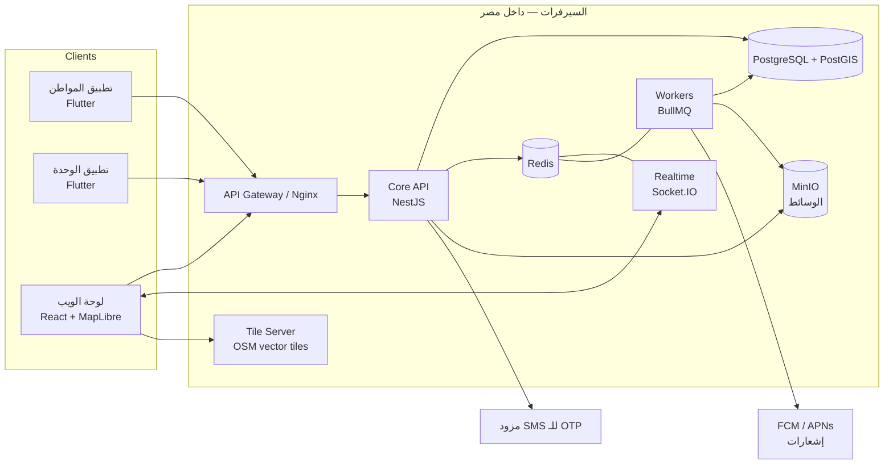

# المعمارية التقنية

## 1. نظرة عامة


## 2. المكوّنات
| المكوّن | التقنية | السبب |
|---|---|---|
| تطبيقات الموبايل | **Flutter** | كود واحد لأندرويد وآيفون، ودعم قوي للعمل بدون إنترنت والكاميرا والـ GPS |
| لوحة الويب | **React + TypeScript + MapLibre GL** | خرائط متجهية سريعة وخريطة حرارية مدمجة، ومن غير رسوم ترخيص |
| الـ API | **NestJS (TypeScript)** | بنية منظمة بوحدات، ونفس لغة الويب |
| قاعدة البيانات | **PostgreSQL 16 + PostGIS** | استعلامات جغرافية (Point-in-Polygon، أقرب بلاغ) وموثوقية عالية |
| الطوابير والمهام | **Redis + BullMQ** | معالجة الوسائط، وفحص مدد الحل والتصعيد، والتقارير |
| اللحظية | **Socket.IO** على Redis adapter | ظهور البلاغات في الغرفة خلال ثوانٍ |
| تخزين الوسائط | **MinIO** (متوافق مع S3) | تخزين محلي داخل مصر |
| الخرائط | **OpenStreetMap** بتايلز مستضافة ذاتياً (OpenMapTiles / Protomaps) | البيانات تفضل محلية ومن غير تكلفة لكل طلب |
| طبقة الأقمار الصناعية | صور المحافظة / هيئة المساحة إن وُجدت، وإلا مزود تجاري بترخيص | انظر ملاحظة الترخيص بالأسفل |
| الإشعارات | FCM (أندرويد) / APNs (آيفون) | مفيش بديل عملي للإشعارات على الموبايل |
| OTP | مزود SMS مصري | تأكيد رقم الموبايل |
| التقارير | Puppeteer (HTML ← PDF) | تقارير بالعربي من اليمين لليسار بنفس الهوية |
| الدخول | OAuth2 / OIDC (Google, Microsoft) + JWT | |

> **ترخيص طبقة الأقمار الصناعية:** صور زي Esri World Imagery و Google ليها شروط ترخيص تمنع الاستخدام الحكومي التشغيلي المجاني. للنموذج التجريبي ممكن نستخدم طبقة عامة، ولكن للإنتاج لازم ترخيص أو صور رسمية من المحافظة. (Sentinel-2 مجاني ولكن دقته 10 م، فمش كفاية لرصد التعديات الفردية.)

## 3. المعالجة الجغرافية
- **التوجيه:** `ST_Contains(unit.geom, report.location)` مع فهرس GiST. لو مفيش نتيجة يبقى البلاغ «خارج النطاق»، ويروح لقائمة المحافظة.
- **التكرار:** `ST_DWithin(location::geography, :point, 50)` + نفس التصنيف + حالة مفتوحة + خلال 14 يوم.
- **التحقق من صورة الحل:** `ST_DWithin(resolution.location, report.location, 100)`.
- **نطاقات الوحدات المبدئية:** `ST_Union` لمضلعات القرى التابعة لكل وحدة من ملف الـ GDB. بعدها تُستبدل بالحدود الرسمية.
- **تجميع النقاط على الخريطة:** Supercluster على العميل لحد 50 ألف نقطة. فوق كده، تايلز متجهية من السيرفر (`ST_AsMVT`).
- نظام الإحداثيات: التخزين بـ WGS84 (EPSG:4326)، والتحويل من نظام ملف الـ GDB عند الاستيراد (غالباً EPSG:22992 Egypt Red Belt أو UTM 36N).

## 4. مسار البلاغ تقنياً
1. التطبيق يحفظ البلاغ محلياً (SQLite) ويضيف العلامة المائية ويضغط الوسائط.
2. الرفع: بيانات البلاغ أولاً، وبعدين الوسائط على أجزاء (Resumable / tus) علشان الشبكات الضعيفة.
3. الـ API يتحقق (الحد اليومي، الموقع داخل المحافظة) ← يحسب الوحدة ← يكشف التكرار ← يحسب الأولوية ومدد الحل ← يحفظ ← يكتب في سجل التدقيق.
4. ينشر حدث `report.created` ← الغرفة والوحدة يستلموه لحظياً، والمواطن يستلم إشعار.
5. Worker كل دقيقة يفحص مدد الحل ويطلق التصعيد.
6. Worker ليلي يعيد حساب المؤشرات ويخزنها في جداول ملخص (`kpi_snapshots`).

## 5. الأمان
- صلاحيات على مستوى الصف (PostgreSQL RLS) حسب `unit_id` و`center_id` للدور.
- تشفير رقم الموبايل والبريد في قاعدة البيانات (pgcrypto)، وإخفاؤهم في الواجهة حسب الإعداد.
- الوسائط بروابط موقّعة مؤقتة (Pre-signed URLs) ومفيش رابط عام.
- سجل التدقيق: جدول إضافة فقط، ومستخدم قاعدة البيانات للتطبيق محروم من UPDATE/DELETE عليه، وكل صف فيه `hash = sha256(prev_hash || row)`.
- تحديد معدل الطلبات (Rate limiting) على الـ OTP وتقديم البلاغات.
- إزالة البيانات الوصفية الحساسة من الصور قبل عرضها لغير المصرّح لهم.

## 6. البيئات والنشر
- `dev` ← `staging` ← `production`، كلها Docker Compose في البداية، ثم Kubernetes عند التعميم لو احتجنا.
- CI/CD: GitHub Actions أو GitLab CI.
- المراقبة: Prometheus + Grafana، والسجلات: Loki.
- النسخ الاحتياطي: `pg_dump` يومي + WAL archiving، ونسخ MinIO لموقع ثانٍ داخل مصر.

## 7. تقدير السعة (1000 بلاغ/يوم)
- متوسط الوسائط بعد الضغط حوالي 3 ميجا للبلاغ، يعني حوالي **3 جيجا/يوم**، وحوالي **1.1 تيرا/سنة** (مع الفيديو ممكن توصل للضعف).
- سيرفر تطبيق: 8 أنوية / 16 جيجا رام، وسيرفر قاعدة بيانات: 8 أنوية / 32 جيجا رام / SSD. والتخزين: 4 تيرا قابلة للتوسع.

## 8. هيكل المستودع المقترح
```
/apps
  /mobile        Flutter (citizen + unit flavors)
  /web           React dashboard (ops, governor, unit, center)
  /api           NestJS
  /workers       BullMQ jobs
/packages
  /design-tokens  generated from brand/tokens.json
  /shared-types
/infra           docker-compose, nginx, tiles
/gis             GDB import scripts, unit boundaries
/seed            demo data
/docs
/brand
```
