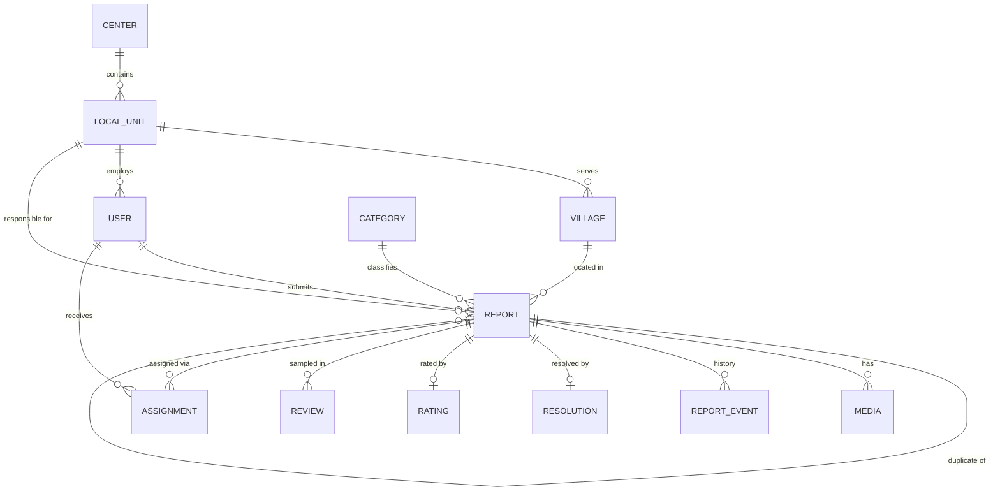

# نموذج البيانات

## 1. المخطط

## 2. الجداول الرئيسية

### الجغرافيا
| الجدول | الحقول المهمة |
|---|---|
| `centers` | id, name_ar, name_en, type (مركز / مدينة), geom MultiPolygon |
| `local_units` | id, center_id, name_ar, name_en, geom MultiPolygon, boundary_source (`derived` / `official`), valid_from, valid_to, hide_reporter bool |
| `villages` | id, local_unit_id, center_id, name_ar, name_en, kind (قرية / حي / مدينة), geom |

> `valid_from` و `valid_to` بيخلّوا التقسيم الإداري بإصدارات، فلو اتغير، البلاغات القديمة تفضل مربوطة بالنطاق اللي كان سارياً وقتها.

### المستخدمون
| الجدول | الحقول المهمة |
|---|---|
| `users` | id, role, full_name, phone_enc, phone_verified_at, email_enc, auth_provider, local_unit_id?, center_id?, parent_user_id? (الموظف ← رئيس الوحدة), locale, is_active, mfa_enabled |
| `devices` | user_id, push_token, platform |

### البلاغات
| الجدول | الحقول المهمة |
|---|---|
| `categories` | id, code, name_ar, name_en, parent_id? (للتصنيفات الفرعية لاحقاً), base_priority, is_emergency, guided_questions jsonb |
| `reports` | id, code (مثلاً `FY-2026-000123`), citizen_id, category_id, description, guided_answers jsonb, voice_media_id?, location Point, location_accuracy_m, location_source (`gps` / `manual`), village_id, local_unit_id, center_id, out_of_scope bool, status, priority, priority_source (`rule` / `manual`), source (`app` / `social` / `ops`), social_url?, master_report_id?, duplicate_count, ack_due_at, resolve_due_at, acknowledged_at, resolved_at, closed_at, sla_paused_ms, reopen_count, created_offline_at, received_at |
| `media` | id, report_id, kind (`photo` / `video` / `audio` / `resolution_photo`), storage_key, from_gallery bool, exif_taken_at?, exif_location?, captured_location?, watermarked bool, size, duration_s |
| `assignments` | report_id, assignee_id, assigned_by, assigned_at, unassigned_at |
| `resolutions` | report_id, action_taken, cause, executing_party, estimated_cost, executed_on, notes, photo_media_id, location Point, distance_m, submitted_by |
| `ratings` | report_id, stars 1–5, resolved bool, comment |
| `reviews` | report_id, type (`rejection_sample` / `resolution_sample` / `field_visit`), reviewer_id, outcome (`match` / `mismatch`), notes, media |
| `report_events` | id, report_id, actor_id, action, from_status, to_status, payload jsonb, created_at |

### التدقيق والإعدادات
| الجدول | الحقول المهمة |
|---|---|
| `audit_log` | id bigserial, actor_id, actor_role, entity, entity_id, action, before jsonb, after jsonb, ip, user_agent, created_at, prev_hash, hash. **إضافة فقط** |
| `settings` | key, value jsonb, updated_by, updated_at. (الحد اليومي، معاملات التكرار، نسب العينات، حدود الإنذار، أوزان المؤشرات، تشغيل صفحة الشفافية) |
| `sla_policies` | priority, ack_minutes, resolve_minutes |
| `priority_rules` | category_id, season_from, season_to, priority, dup_threshold_1, dup_threshold_2 |
| `escalation_rules` | trigger, threshold_pct, target_role |
| `kpi_snapshots` | period, scope (`unit` / `user` / `center`), scope_id, k1…k10, score, rank |

## 3. ملاحظات
- كل الجداول الجغرافية بـ SRID 4326 وعليها فهارس GiST.
- `reports.code` ثابت ويظهر للمواطن وفي التقارير الرسمية.
- الحذف ممنوع على `reports` و`report_events` و`audit_log`. الإلغاء بيتم بتغيير الحالة.
