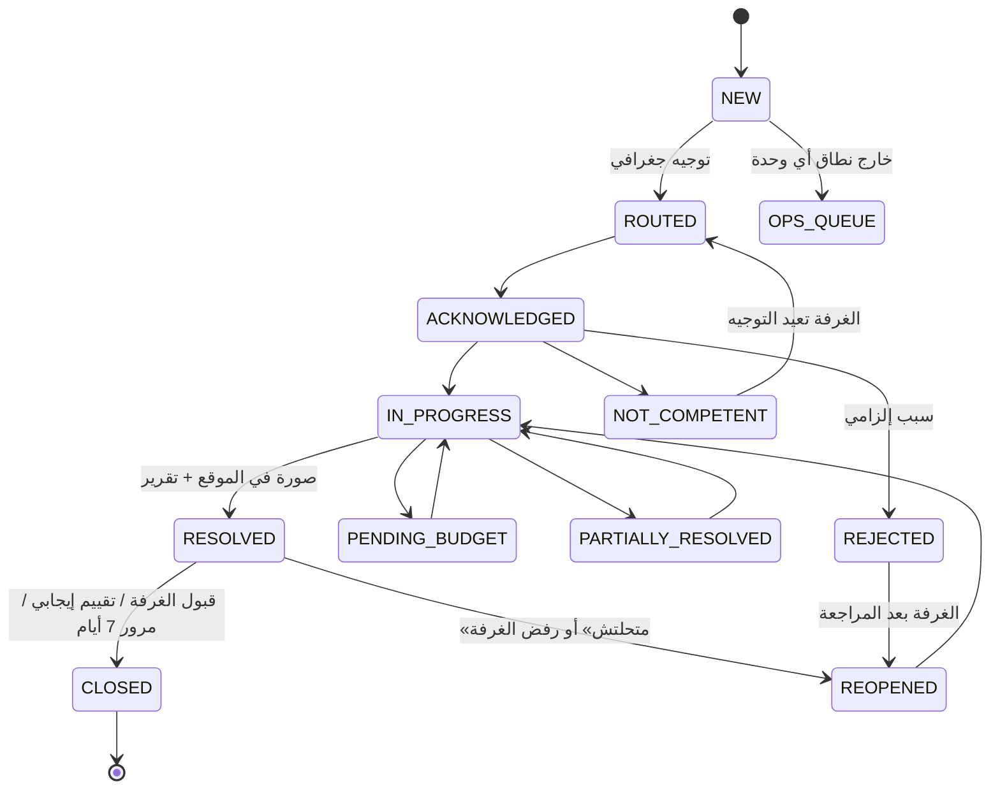

# دورة حياة البلاغ

## 1. الحالات
| الكود | الحالة | مين يحرّكها |
|---|---|---|
| `NEW` | جديد | السيستم عند الاستلام |
| `ROUTED` | محوّل للوحدة | السيستم (توجيه تلقائي) |
| `ACKNOWLEDGED` | تم الاستلام | الوحدة |
| `IN_PROGRESS` | جاري العمل | الوحدة |
| `PENDING_BUDGET` | يحتاج ميزانية / مدرج في خطة | الوحدة |
| `PARTIALLY_RESOLVED` | حل جزئي | الوحدة |
| `RESOLVED` | تم الحل (بانتظار المراجعة والتقييم) | الوحدة |
| `CLOSED` | مغلق | السيستم / الغرفة |
| `REJECTED` | مرفوض | الوحدة (بسبب مكتوب) |
| `NOT_COMPETENT` | ليس من اختصاص الوحدة | الوحدة ← الغرفة |
| `REOPENED` | معاد فتحه | المواطن / الغرفة |

> **ملاحظة:** حالة «قيد المراجعة» اللي كانت في الاقتراح الأول اتشالت من المسار الأساسي، لأن البلاغ بيروح للوحدة تلقائياً. المراجعة بتحصل بعد الحل وعلى عينة من المرفوض.

## 2. المخطط

## 3. قواعد الإغلاق
- البلاغ يتقفل (`CLOSED`) عند أول حاجة من دول: الغرفة قبلت الحل، أو المواطن قيّم بـ«اتحلت»، أو عدّت **7 أيام** على `RESOLVED` من غير اعتراض (المدة قابلة للضبط).
- البلاغ المعاد فتحه بيحتفظ بعدّاد مدة الحل الأصلي، وبيتحسب في مؤشر «نسبة إعادة الفتح».

## 4. الأولوية (قواعد مبدئية قابلة للضبط)
| التصنيف | الأولوية الأساسية |
|---|---|
| طوارئ (حريق، انهيار، كابل مكشوف) | حرج |
| تعدٍّ على أرض زراعية / أملاك دولة (جارٍ)، تجريف | عاجل |
| صرف صحي طافح، انقطاع مياه شرب | عاجل |
| قمامة متراكمة، إنارة، طرق، مصارف، كلاب ضالة | عادي |
| تجميل، لافتات، ملاحظات عامة | منخفض |

**التصعيد التلقائي للأولوية:** لو عدد البلاغات المكررة ≥ 5 ترتفع درجة، ولو ≥ 15 ترتفع درجتين (حد أقصى: حرج).
**القواعد الموسمية:** مثلاً من نوفمبر لفبراير: «تجمعات مياه أمطار» تبقى عاجل. الغرفة بتعرّف القاعدة بفترة وتصنيف وأولوية.

## 5. مدد الحل (SLA) — قيم افتراضية مقترحة للعرض
| الأولوية | الاستلام | الحل |
|---|---|---|
| حرج | 1 ساعة | 24 ساعة |
| عاجل | 4 ساعات | 3 أيام |
| عادي | 24 ساعة | 7 أيام |
| منخفض | 48 ساعة | 14 يوم |

حالة `PENDING_BUDGET` **توقف عدّاد الحل** بعد موافقة الغرفة على المبرر، علشان متتحسبش على الوحدة.

## 6. التصعيد
| عند | يتصعّد إلى |
|---|---|
| تجاوز مدة الاستلام | رئيس الوحدة (تنبيه) |
| تجاوز مدة الحل | رئيس المركز/المدينة |
| تجاوز مدة الحل بنسبة 50% | السكرتير العام / غرفة العمليات |
| تجاوز مدة الحل بنسبة 100%، أو بلاغ «حرج» متأخر | المحافظ (إنذار) |
| المواطن قال «متحلتش» | غرفة العمليات |

## 7. المراجعة والعينات
- **البلاغات المرفوضة:** كلها تظهر للغرفة، والسيستم يختار عينة عشوائية (الافتراضي **20%**) للتواصل مع المواطن.
- **الحلول:** عينة (الافتراضي **10%**) لمراجعة الصور والتقرير، وعينة أصغر لزيارة ميدانية.
- نتيجة المراجعة (مطابق / غير مطابق) بتأثر على مؤشر «مصداقية الوحدة».
